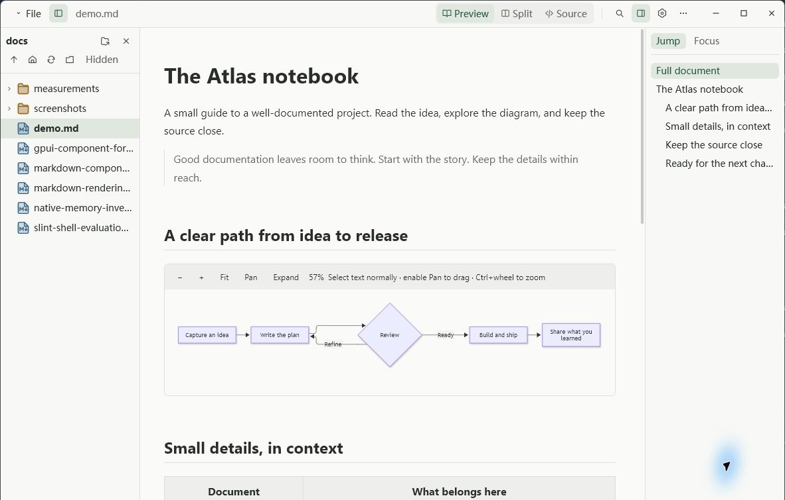
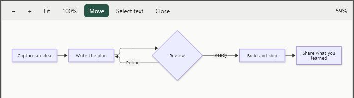
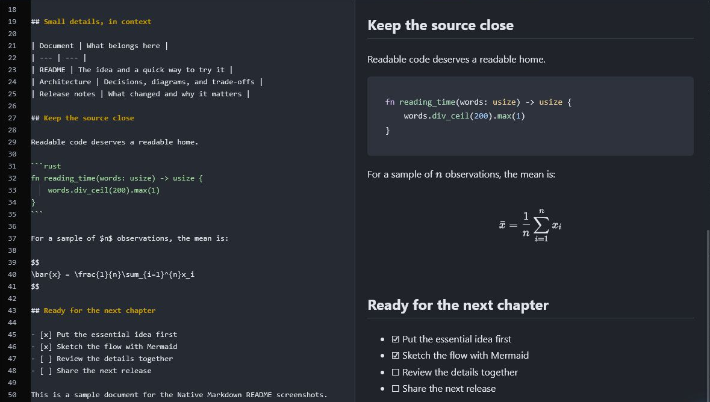

[简体中文](README_zh.md) · English

# Native Markdown

**Give your Markdown room to breathe.**

A reader-first Markdown app for Windows. Open a project README, follow a technical guide, or explore a Mermaid diagram—with clear typography, a document outline, and the source one shortcut away.

Built with **Rust + GPUI**, with **system WebView2** for the reading surface. No Electron or bundled Chromium.

[Get started](#get-started) · [Explore the features](#made-for-the-way-you-read) · [Keyboard shortcuts](#keyboard-shortcuts) · [Report an issue](https://github.com/zaopuppy/native-markdown/issues)



*Your files on the left. The document in the middle. Its structure on the right.*

## Made for the way you read

### Open a README. Stay for the whole project.

Start in reading mode, with the document taking center stage. Browse nearby Markdown files in the folder tree, jump between headings, or use **Focus** to read just one section. The outline highlights your current heading as you scroll the reading pane. Resize the sidebars or hide them when you want more room.

Open a file with `Ctrl+O`, drop it into the window, or pass its path on the command line. Recent files and folders are a click away in the File menu.

### Diagrams you can actually explore

Mermaid diagrams render locally as SVG. Zoom into the details, fit the whole flow, or expand the diagram for a closer look. Switch between moving the diagram and selecting its labels—copying text stays useful even inside a chart.



*Diagram viewer detail. Rendering assets are bundled, so Mermaid works offline.*

An invalid diagram shows its error and source while the rest of the document remains readable. Diagrams near the viewport render first.

### Read the result. Keep the source close.

Press `Ctrl+2` for source and preview side by side. Both panes follow the same Markdown block as you scroll, including wrapped source lines. Turn off **Sync scrolling** whenever you want to compare different passages.

The preview and outline refresh after you stop typing for **1 second** by default. Choose 0.5, 1, 2, 3, or 5 seconds in Settings; this choice applies to the current run. Each edit restarts the delay; saving always uses your latest text. Scroll sync pauses until the preview catches up. Opening a document or explicitly using Find updates immediately.

Settings offers **GitHub (GFM)** (default) and **CommonMark** parsing. **Preserve ordinary line breaks** optionally displays single newlines as visible breaks; it is off by default, following GFM soft-break rules. Both modes retain math and Mermaid support. These settings apply to the current run.

Preview updates reuse unchanged content blocks, including rendered diagrams, formulas, and code highlighting. An unchanged diagram keeps its zoom and expanded viewer; an edited diagram keeps its previous drawing until the new result is ready.



*A crop of the real split view in Midnight. Code, math, and checklists keep their context.*

Use `Ctrl+1` to return to reading or `Ctrl+3` to work in source only. Save the Markdown itself with `Ctrl+S`; atomic saves, unsaved-change prompts, and background recovery help protect your edits.

### Settle into your own reading space

Choose **Paper, Sepia, Sage, Midnight, or Nord**. The window, editor, reading surface, and diagrams share the theme, and your choice carries over to the next launch.

Pick a reading width of **720, 980, 1280 px, or full width**. Zoom the document without enlarging the app controls. By default, the width limit grows as you zoom above 100%; switch that off for a fixed limit.

| When your document contains… | Native Markdown gives you… |
| --- | --- |
| Long guides and nested headings | An outline with Jump and section Focus, plus text search |
| Architecture and process diagrams | Offline Mermaid, SVG zoom, optional pan, and an expanded viewer |
| Code, equations, and structured notes | Syntax highlighting, KaTeX math, tables, task lists, and selectable text |
| Local illustrations | Relative images and a zoomable image viewer |
| A folder full of documentation | A folder tree loaded on demand, keyboard navigation, and an Open in Explorer action |

## Get started

**Current reading platform: Windows x64 with Microsoft Edge WebView2 Runtime.**

Download the portable ZIP from [Releases](https://github.com/zaopuppy/native-markdown/releases), extract it, and run `native-markdown.exe`. Keep the included DLLs beside the executable. If no release has been published yet, build from source using the steps below. [Release workflow and maintainer instructions](docs/releases.md).

You need Git, a Rust MSVC toolchain, the Visual Studio C++ build tools with Windows SDK, and [WebView2 Runtime](https://developer.microsoft.com/microsoft-edge/webview2/). The app uses the system runtime and does not install it silently.

```powershell
git clone https://github.com/zaopuppy/native-markdown.git
cd native-markdown
cargo build --release --locked
.\target\release\native-markdown.exe .\docs\demo.md
```

The [sample notebook](docs/demo.md) is the document used in the screenshots. Try expanding its diagram, switching to Split, and choosing a theme from the gear menu.

To open your own document:

```powershell
.\target\release\native-markdown.exe "C:\path\to\your\notes.md"
```

Launch without a path for the welcome screen. Running the app requires no Node runtime or frontend build step.

## Keyboard shortcuts

| Action | Shortcut |
| --- | --- |
| New / Open | `Ctrl+N` / `Ctrl+O` |
| Save / Save As | `Ctrl+S` / `Ctrl+Shift+S` |
| Find | `Ctrl+F` |
| Next / previous match, with Find focused | `Enter` / `Shift+Enter` |
| Preview / Split / Source | `Ctrl+1` / `Ctrl+2` / `Ctrl+3` |
| Toggle preview and editing | `Ctrl+E` |
| Zoom in / out / reset | `Ctrl++` / `Ctrl+-` / `Ctrl+0` |

Use `Ctrl+mouse-wheel` over the source editor or reading pane to zoom the document; inside a diagram, it zooms that diagram independently. Leave **Pan** off to select inline diagram text. In the expanded viewer, choose **Select text** to copy labels and press `Esc` to return. Click a local image to open its viewer.

With the file tree focused, use `Up` / `Down` to move, `Left` / `Right` to collapse or expand, and `Enter` to open a file.

## Local files, clear boundaries

Your documents stay ordinary UTF-8 Markdown files. Mermaid, math, and code highlighting use bundled assets and work without a CDN.

- Markdown HTML is sanitized. Scripts, iframes, external diagram resources, and runtime Mermaid configuration are blocked.
- Local images and Markdown document links must stay within the active document directory. Remote images are disabled.
- Recent history holds up to **20 files and 20 explicitly opened folders**. It loads once at startup; displaying the list never scans directories or checks recorded paths.

<details>
<summary>Storage and rendering details</summary>

Recent history lives at `%APPDATA%/NativeMarkdown/recent.json`, with a 64 KiB read/write limit. Successfully opening a path absent from its current list triggers one atomic snapshot write. Reopening a listed path only reorders it in memory; there are no timer or exit writes. Following a document's folder implicitly does not add a folder record. Write failures retain the in-memory history and show an error.

Theme and sidebar layout are stored in `%APPDATA%/NativeMarkdown/layout.conf`. Reading-width choices and the scroll-sync toggle stay in memory for the current run. Unsaved-edit recovery uses `%TEMP%/native-markdown-recovery.md`.

Normal Save skips disk access when the text matches its in-memory open/last-save baseline, including edits that were undone. Save As still writes the selected target. `Saved` appears for one second only after a successful document write; opening an unchanged document does not show it.

The reading area is a WebView2 child window inside the native GPUI shell. If initialization fails, the app shows an error; source editing and saving remain available. There is no native preview fallback. Linux and macOS do not yet have a supported reading backend.

Mermaid currently rejects frontmatter, including title-only frontmatter. Limits are 64 diagrams per document, 256 KiB of source per diagram, and 1,500 edges per diagram. Very complex diagrams can still stall the reading surface temporarily.

In section Focus, scroll sync follows the displayed section; scrolling the source outside it leaves the preview in place. Search uses Markdown source mapping, so matches in rendered diagrams, math, or HTML tables may be approximate.

</details>

## For contributors

The app uses official **GPUI Component 0.10.0**, **gpui-pre/platform 0.3.12**, and **Wry 0.57.3**. Rust owns the window, file tree, source editor, and file lifecycle; WebView2 handles reading. The web assets include Mermaid, KaTeX, highlight.js, and DOMPurify with bundled license files in [assets/web/vendor](assets/web/vendor).

See the [rendering evaluation](docs/markdown-rendering-evaluation.md) for architecture decisions, historical measurements, and their limits, and the [component upgrade notes](docs/gpui-component-fork.md) for dependency details. A system WebView still has browser-process costs; historical benchmarks are not performance guarantees for the current build.

<details>
<summary>Development checks and performance measurement</summary>

```powershell
cargo fmt --check
cargo test --all-targets
cargo clippy --all-targets -- -D warnings
cargo build
python scripts/test-delayed-web-preview.py --binary target/debug/native-markdown.exe --runs 3
node --check assets/web/reader.js
uv run --with playwright python scripts/test-web-preview.py --binary target/release/native-markdown.exe
uv run --with playwright python scripts/test-scroll-sync.py --binary target/release/native-markdown.exe
uv run --with playwright python scripts/test-incremental-preview.py --binary target/release/native-markdown.exe
uv run --with playwright --with psutil python scripts/test-outline-follow.py --binary target/release/native-markdown.exe
python scripts/test-delayed-web-preview.py --binary target/release/native-markdown.exe --runs 3
```

The WebView scripts exercise the actual Windows reading backend using an opt-in loopback debugging port. They need no Playwright browser download. Run file-writing tests with isolated temporary configuration and documents.

To measure the host and its WebView2 descendants together:

```powershell
python scripts/make-rendering-fixtures.py
.\scripts\measure-rendering.ps1 -Binary target\release\native-markdown.exe -Runs 3 -Seconds 12 -Output tmp\webview.json
python scripts/summarize-rendering.py tmp\webview.json
```

Keep Private Bytes, Private Working Set, and shared Working Set distinct. The retired native renderer's budgets do not describe today's WebView architecture.

</details>

Found a document that renders badly or an interaction that gets in your way? [Open an issue](https://github.com/zaopuppy/native-markdown/issues) with a small sample, the app revision, and your Windows/WebView2 versions. Focused fixes and reproducible reports are welcome.

<!-- Screenshots: actual Windows release app, captured 2026-11-22 using docs/demo.md and isolated APPDATA/WebView2 profiles. Detail images are crops; no UI mockups. -->
