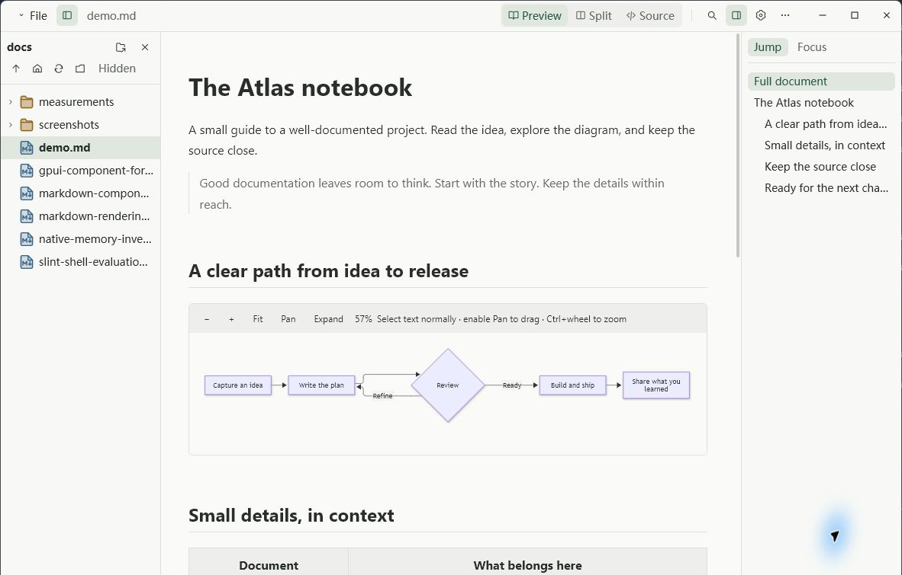
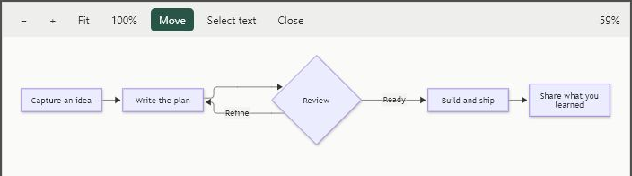
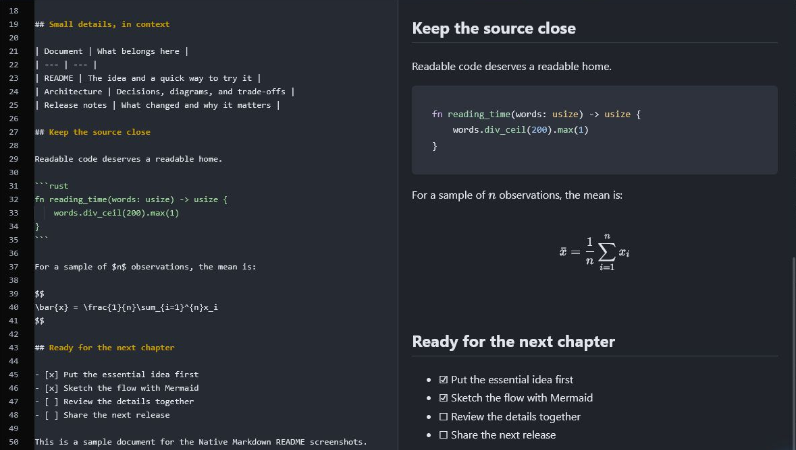

[English](README.md) · 简体中文

# Native Markdown

**让 Markdown 回到阅读本身。**

一个为 Windows 打造、把阅读放在首位的 Markdown 应用。打开项目 README、读一篇技术长文、看懂一张 Mermaid 图：清晰的排版、随手可达的目录，以及一个快捷键就能打开的源码。

采用 **Rust + GPUI 原生界面**，阅读区域使用**系统 WebView2**。无需 Electron，也不捆绑 Chromium。

[开始使用](#开始使用) · [看看能做什么](#为日常阅读而设计) · [快捷键](#快捷键) · [反馈问题](https://github.com/zaopuppy/native-markdown/issues)



*左边找文件，中间读内容，右边看结构。*

## 为日常阅读而设计

### 从一篇 README，读到整个项目

打开文档就进入阅读模式。用左侧文件树浏览同目录下的 Markdown，用右侧目录跳转章节；想专心读某一节，切换到 **Focus** 即可。两侧栏可以调整宽度，也可以收起，把空间留给正文。

按 `Ctrl+O` 打开文件，把文件拖进窗口，或从命令行传入路径。刚看过的文件和文件夹，可以在 File 菜单中重新打开。

### 图表里的细节，值得看清楚

Mermaid 在本地渲染为 SVG。放大查看细节，用 **Fit** 看全局，或点 **Expand** 展开查看。在移动图表和选择文字之间切换，图里的标签也能选中、复制。



*图表查看器局部实拍。渲染资源随应用内置，离线也能看图。*

某张图写错了，会显示错误和源码，其余正文仍然可读。图表靠近可见区域时才开始渲染。

### 读到想改的地方，源码就在旁边

按 `Ctrl+2` 打开分栏，左边源码，右边排版结果。滚动任意一侧，另一侧会跟随到对应的 Markdown 内容块，源码自动折行也能对应。需要对照不同段落时，关闭 **Sync scrolling** 即可。

预览和目录在停止输入 **3 秒后**刷新，每次编辑都会重新计时；保存始终使用最新源码。等待刷新期间暂停滚动同步，预览更新后恢复。打开文档或主动使用查找时立即更新。

更新预览时会复用未修改的内容块，包括已渲染的图表、公式和代码高亮。未修改的图表保留缩放与展开查看状态；修改图表时，旧图会保留到新结果准备完成。



*真实分栏界面的局部截图：代码、公式、清单，连同上下文一起看。*

按 `Ctrl+1` 回到阅读，按 `Ctrl+3` 专心编辑源码。`Ctrl+S` 保存的是 Markdown 原文；原子保存、未保存提醒和后台恢复记录，为修改多留一层保障。

### 找一个适合久读的样子

**Paper 纸白、Sepia 暖纸、Sage 鼠尾草、Midnight 午夜、Nord 北欧**，五种主题可选。窗口、编辑器、正文和图表一起切换，下次打开沿用你的选择。

阅读宽度可以选择 **720、980、1280 px 或铺满**。放大正文时，应用按钮保持原有大小。默认在超过 100% 时随缩放扩展宽度上限，也可以关闭，让宽度保持固定。

| 你正在读…… | 可以用到…… |
| --- | --- |
| 层级很多的技术长文 | 章节目录、Jump 跳转、Focus 专注阅读与文字查找 |
| 架构说明、流程设计 | 离线 Mermaid、SVG 缩放、可选拖动与展开查看 |
| 代码、公式、结构化笔记 | 语法高亮、KaTeX 数学公式、表格、任务列表与文字选择 |
| 带本地插图的文档 | 相对路径图片，以及可缩放的图片查看器 |
| 一整个文档目录 | 按需加载的文件树、键盘导航，以及在资源管理器中打开当前文件夹 |

## 开始使用

**当前阅读平台为 Windows x64，需要 Microsoft Edge WebView2 Runtime。**

从 [Releases](https://github.com/zaopuppy/native-markdown/releases) 下载免安装 ZIP，解压后运行 `native-markdown.exe`，将随包 DLL 保留在程序旁边。如果还没有发布版本，可以按下面的步骤从源码构建。[自动发布流程与维护说明](docs/releases.md)。

准备 Git、Rust MSVC 工具链、带 Windows SDK 的 Visual Studio C++ 构建工具，以及 [WebView2 Runtime](https://developer.microsoft.com/microsoft-edge/webview2/)。应用使用系统 Runtime，不会静默安装。

```powershell
git clone https://github.com/zaopuppy/native-markdown.git
cd native-markdown
cargo build --release --locked
.\target\release\native-markdown.exe .\docs\demo.md
```

[示例笔记](docs/demo.md) 就是截图中的文档。可以先试试展开图表、切换 Split 分栏，再从齿轮菜单选一个喜欢的主题。

打开你自己的文档：

```powershell
.\target\release\native-markdown.exe "C:\path\to\your\notes.md"
```

不传路径会进入欢迎页。运行应用无需 Node 环境，也没有前端构建步骤。

## 快捷键

| 操作 | 快捷键 |
| --- | --- |
| 新建 / 打开 | `Ctrl+N` / `Ctrl+O` |
| 保存 / 另存为 | `Ctrl+S` / `Ctrl+Shift+S` |
| 查找 | `Ctrl+F` |
| 查找框内下一个 / 上一个匹配 | `Enter` / `Shift+Enter` |
| 阅读 / 分栏 / 源码 | `Ctrl+1` / `Ctrl+2` / `Ctrl+3` |
| 切换阅读与编辑 | `Ctrl+E` |
| 放大 / 缩小 / 重置 | `Ctrl++` / `Ctrl+-` / `Ctrl+0` |

`Ctrl+鼠标滚轮` 缩放正文；在图表内使用时，只缩放该图。关闭 **Pan** 可以选择内联图表里的文字；展开后用 **Select text** 复制标签，按 `Esc` 返回正文。点击本地图片可打开图片查看器。

文件树获得焦点时，用 `↑` / `↓` 移动，`←` / `→` 收起或展开，`Enter` 打开文件。

## 本地文档，清楚的边界

文档始终是普通的 UTF-8 Markdown 文件。Mermaid、数学公式和代码高亮使用内置资源，无需连接 CDN。

- Markdown 中的 HTML 会经过清洗，脚本、iframe、外部图表资源与 Mermaid 运行时配置会被阻止。
- 本地图片和 Markdown 文档链接限制在当前文档目录内，远程图片禁用。
- 最近记录分别保留最多 **20 个文件、20 个显式打开的文件夹**。启动只读取一次，展示列表不会扫描目录或检查历史路径。

<details>
<summary>存储与渲染细节</summary>

最近记录位于 `%APPDATA%/NativeMarkdown/recent.json`，读写上限为 64 KiB。仅成功打开且不在当前对应列表内的路径触发一次原子快照写入。列表内重开只调整内存顺序，没有定时写入或退出补写；随文档隐式跟随的目录不另记文件夹。写入失败时保留内存记录并显示错误。

主题与侧栏布局保存在 `%APPDATA%/NativeMarkdown/layout.conf`。阅读宽度和分栏滚动同步开关只在本次运行内保留。未保存修改的恢复文件位于 `%TEMP%/native-markdown-recovery.md`。

普通保存会在内存中比较当前正文与打开或上次保存时的内容；内容未变（包括修改后撤销）时跳过磁盘访问。另存为仍写入所选目标。只有正文实际写入成功才显示 `Saved`，1 秒后消失；打开未修改的文档不会显示该提示。

阅读区是嵌入 GPUI 原生窗口的 WebView2 子窗口。初始化失败时会明确报错，仍可编辑源码和保存；没有原生预览兜底。Linux、macOS 暂无受支持的阅读后端。

Mermaid 暂不支持 frontmatter，包括仅含 title 的 frontmatter。每篇文档最多 64 张图，每图源码最多 256 KiB、最多 1,500 条边；特别复杂的图仍可能暂时阻塞阅读区域。

Focus 模式下，滚动同步只跟随当前显示章节；源码滚出该章节时，预览保持原位。查找使用 Markdown 源码映射，图表、公式或 HTML 表格中的命中可能只能近似定位。

</details>

## 参与开发

项目使用官方 **GPUI Component 0.10.0**、**gpui-pre/platform 0.3.12** 与 **Wry 0.57.3**。Rust 负责窗口、文件树、源码编辑和文件生命周期，WebView2 负责阅读。Mermaid、KaTeX、highlight.js、DOMPurify 的资源与许可证随项目保存在 [assets/web/vendor](assets/web/vendor)。

[渲染架构评估](docs/markdown-rendering-evaluation.md) 记录了方案取舍、历史测量和测量边界；依赖迁移见[组件升级说明](docs/gpui-component-fork.md)。系统 WebView 仍有浏览器进程成本，历史基准不代表当前构建的性能保证。

<details>
<summary>开发检查与性能测量</summary>

```powershell
cargo fmt --check
cargo test --all-targets
cargo clippy --all-targets -- -D warnings
node --check assets/web/reader.js
uv run --with playwright python scripts/test-web-preview.py --binary target/release/native-markdown.exe
uv run --with playwright python scripts/test-scroll-sync.py --binary target/release/native-markdown.exe
python scripts/test-delayed-web-preview.py --binary target/release/native-markdown.exe --runs 3
```

WebView 脚本通过显式启用的本机调试端口，检查真实 Windows 阅读后端，无需下载 Playwright 浏览器。涉及文件写入的测试应使用隔离的临时配置与文档。

测量宿主与 WebView2 后代进程的整体成本：

```powershell
python scripts/make-rendering-fixtures.py
.\scripts\measure-rendering.ps1 -Binary target\release\native-markdown.exe -Runs 3 -Seconds 12 -Output tmp\webview.json
python scripts/summarize-rendering.py tmp\webview.json
```

请区分 Private Bytes、Private Working Set 与包含共享页的 Working Set。已退休的原生渲染器预算不适用于当前 WebView 架构。

</details>

遇到排版问题，或觉得某个操作打断了阅读？欢迎[提交 Issue](https://github.com/zaopuppy/native-markdown/issues)，附上最小示例、应用版本或提交号，以及 Windows / WebView2 版本。也欢迎带着可复现案例和小范围修复参与改进。

<!-- 截图：2026-11-22 使用实际 Windows release 应用、docs/demo.md 和隔离 APPDATA / WebView2 配置拍摄。局部图仅作裁剪，未使用界面效果图。 -->
