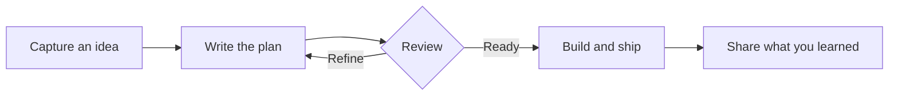

# The Atlas notebook

A small guide to a well-documented project. Read the idea, explore the diagram, and keep the source close.

> Good documentation leaves room to think.
> Start with the story. Keep the details within reach.

## A clear path from idea to release



## Small details, in context

| Document | What belongs here |
| --- | --- |
| README | The idea and a quick way to try it |
| Architecture | Decisions, diagrams, and trade-offs |
| Release notes | What changed and why it matters |

## Keep the source close

Readable code deserves a readable home.

```rust
fn reading_time(words: usize) -> usize {
    words.div_ceil(200).max(1)
}
```

For a sample of $n$ observations, the mean is:

$$
\bar{x} = \frac{1}{n}\sum_{i=1}^{n}x_i
$$

## Ready for the next chapter

- [x] Put the essential idea first
- [x] Sketch the flow with Mermaid
- [ ] Review the details together
- [ ] Share the next release

This is a sample document for the Native Markdown README screenshots. Open it in the app to explore the reading, diagram, and split views.
